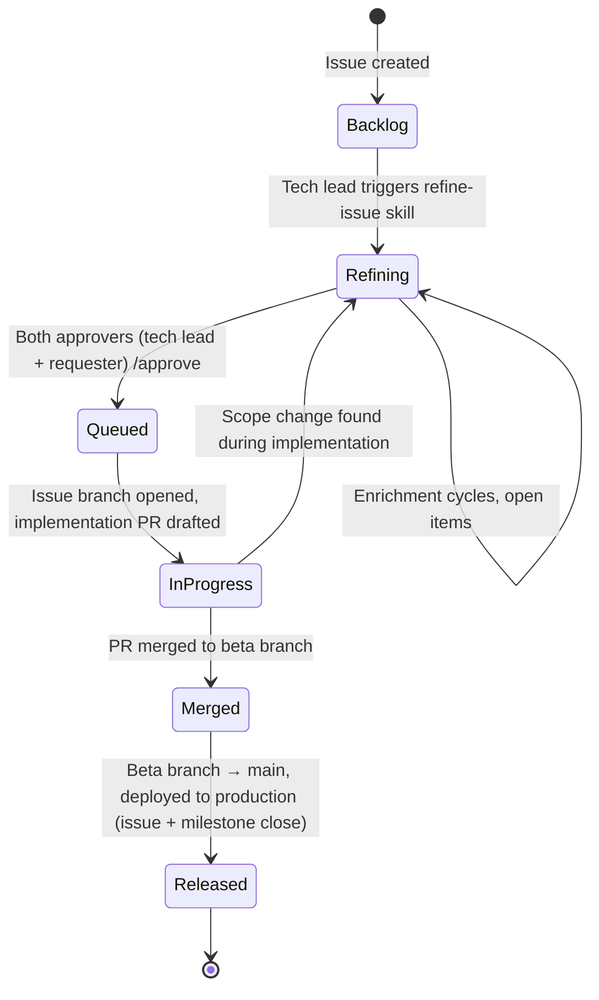

# Process: Issue Lifecycle

## Purpose

This document defines how an issue — feature request, bug report, or task — flows from initial stakeholder submission through implementation and release. The process is designed for:

1. **Stakeholder readability** — non-engineering stakeholders can read every artifact in the audit trail.
2. **Audit traceability** — discrete review events with named reviewers, timestamps, and rationale.
3. **Skill-leveraged orchestration** — automated assistance via Claude skills (`refine-issue`, `review-pr`) at the workflow stages where mechanical verification helps the tech lead focus on judgement.
4. **Single-tech-lead reality** — the process assumes one orchestrator (the tech lead) rather than specialized PM / QA / Eng Manager roles.

## Branching model

This project uses a **beta-branch pattern**:

```
issue/<issue-N>-<slug>  ──┐
                            ├──▶  beta/vX.Y.Z  ──▶  main
issue/<issue-M>-<slug>  ──┘
```

- **`main`** reflects *released* state. Specs and code on `main` represent shipped reality.
- **Beta branches** (`beta/v1.0.1`, `beta/v4.2.1`, etc.) accumulate the work for an upcoming release. Multiple issue branches merge here as work completes. Parallel beta branches are allowed; see [Environments](./environments.md) for how each gets its own pre-production environment.
- **Issue branches** are short-lived and named `issue/<issue-N>-<slug>`. They branch off the target beta branch and merge back into it when implementation is verified. Branching off `main` instead skips parallel in-flight beta work and produces noisier merge diffs.
- **Release event:** when a beta branch merges into `main`. This is the bug-eligibility threshold (see Defect handling below).
- **No feature flags** in current scope. "Released to users" = "merged to `main` and deployed to production."

This pattern supports batched releases when coordination is needed without forcing strict trunk-based development. See [Environments](./environments.md) for how branches map to deployment environments.

## State machine



| State | Meaning | How it enters | How it exits |
|---|---|---|---|
| **Backlog** | Issue exists; no refinement begun | Default on creation | Tech lead moves to `Refining` |
| **Refining** | Tech lead is enriching the issue and aligning with stakeholder | Manual move from `Backlog`, or scope-change return | Both approvers (tech lead + requester) commented `/approve` → `Queued` |
| **Queued** | Issue is approved with full scope visible; ready for implementation | Both approvers' `/approve` comments received | Issue branch opened → `InProgress` |
| **InProgress** | Implementation PR is open against the beta branch | Issue branch + PR created | PR merged → `Merged` |
| **Merged** | Issue branch merged to beta branch; issue stays **open** pending release validation | PR merged | Beta branch merged to main → `Released` |
| **Released** | Code is merged to `main` and deployed to production; the issue and the release milestone close | Beta branch → main | Terminal state |

## Roles

| Role | Responsibilities |
|---|---|
| **Stakeholder / Requester** | Files the initial issue; reviews skill-enriched body during refinement; provides `/approve` when the refined understanding captures their need |
| **Tech Lead** | Orchestrates the flow; manually invokes the `refine-issue` skill; maintains issue body state; arbitrates clarification-vs-scope-change calls; provides `/approve` from the engineering side; reviews PRs informed by `review-pr` skill output |
| **Developers** | Engaged only after `Queued` state. Implementation work happens after both `/approve` comments. |
| **Refine-Issue Skill** *(future)* | Assists the tech lead during refinement — see [Skill Responsibilities](#skill-responsibilities-future) |
| **Review-PR Skill** *(future)* | Assists the reviewer by performing mechanical checks on the PR and posting findings — see [Skill Responsibilities](#skill-responsibilities-future) |

## Stage 1 — Intake

The stakeholder files an issue using one of the three templates (`feature_request.yml`, `bug_report.yml`, `task.yml`). The template requires:

- A **problem statement** covering who is affected, what is happening, and why it hurts / what it costs.
- **Acceptance criteria** (for features) or **definition of done** (for tasks), each item observable pass/fail.
- Plus template-specific fields (e.g., expected/actual/repro for bugs).

Optional:
- **References** — links to related issues, design docs, customer asks.

The issue is created in **`Backlog`** state via the Project's "Auto-add to project on issue creation" workflow (see [Queueing and pickup](#queueing-and-pickup)). Stakeholders do **not** populate workflow metadata (Status, Block reason, Priority, Complexity) — those belong on GitHub Project fields, assigned by the tech lead during triage.

## Stage 2 — Refinement

The tech lead manually triggers the **`refine-issue` skill** when an issue is ready to be worked on. Manual triggering — rather than automatic-on-create — preserves tech-lead control over when stakeholders and developers are engaged.

When refinement begins:

1. Issue moves from `Backlog` → `Refining`.
2. The skill enriches the issue body in one unified pass:
   - Initializes `## Approvals` summary line and `## Open items` section (if first run).
   - Verifies intake completeness (problem statement covers who/what/cost; acceptance criteria are testable).
   - Searches the backlog for likely duplicates.
   - Checks for conflicts against current plan scope and existing specs' "Out of scope" sections.
   - **Performs codebase analysis** — identifies affected files, modules, schemas, and integration points based on the issue's intent.
   - **Performs risk assessment** — surfaces technical, security, data, schedule, or compliance risks.
   - **Drafts a spec-amendment outline** — which existing `docs/specs/<capability>.md` files will need to change, and what kind of changes (so the tech lead can confirm the spec impact before approval).
3. The skill **proposes** body edits for tech-lead review; nothing is auto-applied.
4. Concerns requiring judgement are elevated during invocation (interactive review).

This stage **front-loads scoping**. By the time the issue reaches `Queued`, both the stakeholder and the tech lead have seen the full picture — including downstream technical impact like schema changes, lambda updates, or infrastructure work that wasn't obvious from the initial request.

### Body-as-state pattern

The issue body is the **canonical current state** during refinement:

| Lives in body | Lives in comments |
|---|---|
| `## Approvals` section | `/approve` events (discrete audit events) |
| `## Open items` list (current state) | Open-item answers from stakeholders |
| Refined problem statement, AC, references | General conversation |
| Codebase analysis (skill-added, collapsible via `<details>`) | Substantive judgement calls |
| Risk assessment (skill-added, collapsible) | |
| Proposed spec-amendment outline (skill-added, collapsible) | |
| Resolution annotations with comment links | |

Collapsible `<details>` sections keep skill-added content navigable without overwhelming readers focused on intake content.

### Open items workflow

The `## Open items` list in the body is **curated by the tech lead**. It represents scope-relevant, approval-blocking questions — not all open conversation. Questions stay in comments unless they meet the elevation criterion:

> *"If this question is unanswered, does it prevent approval or change the scope?"*

If yes → elevate to open items. If no → answer in comments, or redirect ("worth a separate issue?").

When a question arises:

1. Anyone (stakeholder, developer, tech lead) asks the question in a **comment**.
2. The tech lead (or the `refine-issue` skill on its next run, with tech-lead approval) evaluates the elevation criterion.
3. If elevation is warranted: the tech lead adds the question to `## Open items` as a new bullet and tags the responder in a follow-up comment.
4. The tagged party responds in a comment.
5. The tech lead edits the body to mark the item resolved with a struck-through entry and a link to the resolving comment:
   ```markdown
   ## Open items
   1. ~~What is the threshold for "fast"?~~ → Resolved 2026-05-18: p95 ≤500ms (comment #12)
   2. What is the expected behavior on partial failure?
   ```

### Approval mechanism

Both the tech lead and the original requester approve via comments containing exactly:

```
/approve
```

Each `/approve` is a discrete audit event (review evidence). The body's `## Approvals` section is updated by the skill on its next run (or manually) and lists both approvers with their current state:

```markdown
## Approvals
- 🟢 Tech lead — @<tech-lead> (2026-05-18, comment #14)
- ⏳ Requester — pending
```

When both approvals are present → `Queued`. **Substantive design approval happens here, once.** Subsequent PR review is delivery confirmation, not re-litigation of design.

### Non-success outcomes

Refinement may conclude that the issue should not proceed. The tech lead closes the issue with a comment documenting the reason — common categories include duplicate, out of scope, decomposition into child issues, insufficient value, technical infeasibility, or already addressed.

### Tech lead's review

Issues in `Refining` are the tech lead's responsibility — check that issues aren't stalled, apply skill-proposed body edits, surface aging items.

## Stage 3 — Implementation

When the issue reaches `Queued`, the developer creates an issue branch (`issue/<issue-N>-<slug>`) off the active beta branch and opens a draft **implementation PR**.

**The PR is the single delivery event.** It contains code, spec amendments to `docs/specs/<capability>.md` (with rationale in each spec's "Why this design" section), and feature file additions or edits in `docs/features/`.

There is **one PR per issue**. The codebase analysis and spec-amendment outline that drove the work are already captured in the issue body from Stage 2; the PR description is verification-focused — see [`PULL_REQUEST_TEMPLATE/issue-pr.md`](../../.github/PULL_REQUEST_TEMPLATE/issue-pr.md) for the field structure.

**Link the PR to the issue via the Development sidebar.** After opening the PR, open the linked issue and use the right-sidebar `Development` → `Link a pull request` picker to attach the PR. This populates the issue's `Linked pull requests` Project field, surfacing the PR (with state — open/merged/closed) on the issue's Project card as a code-review-ready signal for stakeholders.

The `Closes #N` keyword in the PR body alone doesn't create this link — GitHub only honors closing keywords for PRs targeting the default branch (`main`), and ours target `beta/*`. The sidebar link creates the structured `closingIssuesReferences` relationship that the field reads from.

**Two manual Project-board moves bracket the PR.** GitHub's Project workflows can't automate either transition for this methodology (the `Pull request merged` workflow targets the PR card, not the linked issue — see [Project workflows § disabled list](#project-workflows)). Both are one click in the issue's right-sidebar `Status` dropdown:

1. **At pickup** — `Queued → In Progress` when the developer self-assigns and opens the PR (see [Queueing and pickup](#queueing-and-pickup)).
2. **At PR merge** — `In Progress → Merged` when the tech lead merges the issue PR. Bundle this with the merge itself: merge the PR, then set the issue's Status to `Merged`.

When the PR is opened (and on each subsequent push), the **`review-pr` skill** posts a comment with the results of mechanical checks — issue state, spec-amendment matching, breaking-change detection, scope-creep flagging. The skill's output is informational; it doesn't gate the merge.

PR review confirms delivery against the agreed scope. Design review already happened at refinement; PR review is lighter.

### Mid-implementation surprises

When implementation surfaces an issue not captured in the refined intent:

- **Clarification** (no scope change): resolve on the PR; no return to `Refining`.
- **Scope change** (AC, schema, or affected systems shift): the issue returns to `Refining`. Existing approvals are invalidated. The PR is parked as draft until re-approval. Once re-approved, work resumes on the same PR.

### Trivial issues

Some issues (typos, doc-only changes, cosmetic fixes) don't warrant the full flow. These can skip refinement (or have a brief one), open a PR directly, and merge once verified.

## Stage 4 — Release validation

When the issue's PR merges to its beta branch, Status moves from `InProgress` to `Merged`. The issue is then *Merged* but not yet *Released* — it is part of the beta branch's accumulated work and awaits release-level validation.

**Stakeholder validation happens at release scope, not per-issue.** The beta branch deploys to the version-stamped Beta environment (see [Environments § Beta](./environments.md#beta)) where stakeholders perform UAT on the assembled release. Pre-release defects discovered here reopen the originating issue as incomplete work rather than spawning new bug tickets — see [Defect handling](#defect-handling-pre-release-vs-post-release).

**Two PR review events, two audiences.** The `issue/<N>-<slug>` PR review (against the beta branch) is the code-level review by developers and tech lead, recorded via the Reviewer Checklist in [`PULL_REQUEST_TEMPLATE/issue-pr.md`](../../.github/PULL_REQUEST_TEMPLATE/issue-pr.md). The `beta/* → main` PR review is the deploy-approval event, recorded via [`PULL_REQUEST_TEMPLATE/release-pr.md`](../../.github/PULL_REQUEST_TEMPLATE/release-pr.md) — UAT outcomes and (where implemented) smoke-check status as review evidence; see [Environments § Prod](./environments.md#prod).

Once the release PR merges to `main` and the deploy lands, all issues in the release transition from `Merged` to `Released` simultaneously. `Released` is a terminal state — post-release defects spawn new bug tickets via the bug template (see [Defect handling](#defect-handling-pre-release-vs-post-release)).

## Exception: Big design events

For changes large enough that the design itself warrants its own review event before any implementation:

- File a **task issue** explicitly for the design work (a "spec spike").
- AC: *"Spec amendments produced for `<capability>.md` including 'Why this design' rationale for the chosen approach. No implementation code."*
- This task follows the same refinement flow. The resulting PR contains spec amendments but no implementation code.
- Subsequent feature/task issues implement against the now-merged design.

Use sparingly — only when the design event is substantial enough to merit its own review cycle (sweeping refactors, new architectural approaches, replacing core dependencies).

## Exception: Automated dependency updates

Automated dependency-update tools (Dependabot, Renovate, etc.) open PRs without a linked issue and target `main` directly. These PRs are an allowed exception to the standard `issue → beta branch → main` flow:

- **No linked issue.** No issue is created, no Stage 2 refinement happens, no `/approve` comments are exchanged. The tool's PR description is the artifact of record; the PR review event is the sole audit anchor.
- **Direct target on `main`.** No `beta/*` branch is involved. Each PR is treated as its own micro-release — merge to `main` is the release event, and the `main = released` invariant in [Branching model](#branching-model) holds because the production deploy follows automatically (see [Environments § Prod](./environments.md#prod)).
- **The [State machine](#state-machine) does not apply.** Because no issue exists, these PRs are not tracked through the standard states; they go straight to PR review and merge.

**PR review still applies.** A CODEOWNER reviews each PR and merges manually after approval; the PR review approval is the audit event, analogous to the `beta/* → main` deploy-approval event for ordinary releases. Major-version updates warrant extra scrutiny — breaking-change exposure — but go through the same review-and-merge flow as other dependency updates.

**SHA-pinning convention.** GitHub Actions referenced in `.github/workflows/*.yml` must be pinned to a full commit SHA with a trailing version comment (e.g., `uses: actions/checkout@<full-sha> # v4.2.2`). Dependabot updates both the SHA and the comment together. Pinning by tag (e.g., `@v4`) is not allowed — tags are mutable and a known supply-chain risk.

## Defect handling: pre-release vs post-release

This project draws a sharp line at the **release event** (beta branch merged to `main`).

**Pre-release defects** — found in test environments, CI failures after issue-branch merge to beta branch, stakeholder UAT before the beta branch ships, or any time the affected code has not yet reached `Released` state — are **not bugs**. They are **incomplete work** on the original issue:

- The original issue — open throughout beta — moves back to `In Progress` (implementation gap) or `Refining` (scope gap), depending on cause; its Project `Status` returns accordingly. (Nothing is "reopened" — the issue does not close until `Released`.)
- Multiple PRs may reference the same original issue.
- If the issue returned to `Refining`, existing `/approve` events are invalidated.
- The bug template is **not** used.

**Post-release defects** — found in production after the beta branch has merged to `main` (state `Released`) — ARE bugs:

- New issue filed using the bug template.
- Independent state-machine progression.
- May reference the originating feature/task for context.

**Why:** Post-release defects cleanly map to nonconformity events; pre-release findings remain design-control matters. Treating pre-release issues as "bugs" would let work be reported as complete prematurely.

## Cross-cutting

### Project fields

Workflow-state metadata lives on the GitHub Project, not in the issue body or as labels (labels are reserved for *content classification* — see [Labels](#labels) below). Four single-select fields capture dimensions that change independently:

| Field | Values | Set by | When |
|---|---|---|---|
| **Status** | `Backlog` / `Refining` / `Queued` / `In Progress` / `Merged` / `Released` | Tech lead | Mirrors the state machine above; updated on every state transition. |
| **Block reason** | `Needs clarification` / `Awaiting approval` / `External system` | Tech lead | Set when forward motion stalls; cleared when the block resolves. Orthogonal to Status — an issue can be `In Progress` AND `Block reason: External system` simultaneously. |
| **Priority** | `P1` / `P2` / `P3` / `P4` | Tech lead | Set at triage (move from `Backlog` → `Refining`). May change on external signal (deadline shift, escalation). `P3` is typical, `P1` is urgent, `P4` is "eventually." |
| **Complexity** | `C1` / `C2` / `C3` / `C4` | Tech lead | Set during refinement once scope is understood. `C2` is the typical well-scoped feature, `C1` is trivial/routine with low risk, `C4` is a strong candidate for decomposition into smaller issues. |

**Why fields, not labels:** Project fields carry single-select discipline (one value at a time per field), are queryable in Project views, and don't drift the way labels do (which accumulate from many sources and frequently go stale).

**Block reason is orthogonal to Status:**
- `Blocked` is *not* a Status value. An issue stays in its actual Status while `Block reason` is set.
- When the block clears, only `Block reason` is cleared. Status doesn't need to be restored.
- This preserves underlying lifecycle state during a block — important at team scale, where the person resolving the block isn't necessarily the same one who set it.

**Block reason — typical usage:**
- `Needs clarification` — a pending question in the comments awaits a response (any direction: stakeholder, developer, tester).
- `Awaiting approval` — substantive work is complete; a required `/approve` or PR review signature is missing.
- `External system` — forward motion requires something outside our control: a library upgrade, CI restoration, third-party API, or vendor support resolution.

**C4 carries a workflow signal, not just sizing:** an issue assessed `C4` during refinement should trigger consideration of decomposition into smaller issues *before* it moves to `Queued`. If `C4` issues accumulate in `Queued` or `In Progress` for long stretches, the refinement step likely needs more weight.

**Implementation note:** A new GitHub Project ships with a default `Status` field whose options are `Todo / In Progress / Done`. `scripts/setup.sh` Step 4 updates the `Status` options to match the state machine and creates the `Block reason`, `Priority`, and `Complexity` fields. Enabling the three Project workflows ([below](#project-workflows)) remains a manual UI follow-up — see [Open questions / future work](#open-questions--future-work).

### Project workflows

The GitHub Project's Workflows tab provides built-in automation rules. Three are enabled:

| Workflow | Trigger | Effect |
|---|---|---|
| **Auto-add to project** | New issue created in the linked repo | Adds the issue to the Project (no field values set; see next row). |
| **Item added to project** | Any item is added to the Project | Sets the new item's `Status` to `Backlog`. |
| **Auto-archive items** | Items with `Status: Released` that have been closed for ≥1 week | Archives the item — still queryable, removed from default views. |

**Configuration notes:**

- **Set the Auto-add filter to `is:issue is:open`.** GitHub ships a default that includes PRs as well as issues; that's not what we want. PRs aren't Project items in this methodology (see below) — letting them onto the board duplicates the work as discrete PR cards instead of letting the issue's `Status` field track the work end-to-end.
- **Auto-add adds items; it does *not* set field values.** Field defaults are the job of the `Item added to project` workflow (next bullet). Without that companion enabled, new items land on the board with empty Status.
- **Item added to project needs the toggle AND an action configuration.** Enable it and set the action to "Set Status → Backlog." This is what realizes the state-machine's `Backlog` entry state for new issues.
- **Project items are issues, not PRs.** The Auto-add filter excludes PRs because a PR is the implementation artifact of an issue, not a separate work item; the issue's `Status` field tracks the work end-to-end.
- **The `Linked pull requests` Project field is manual in this model.** It's a default Project field — add it to your view's columns to see it. The field reads from GitHub's `closingIssuesReferences` relationship, which only forms when a PR uses a closing keyword (`Closes #N`) *and* targets the repository's default branch. Issue PRs in this methodology target `beta/*`, so the keyword produces a textual cross-reference in the issue timeline but not a structured Linked-PR relationship. To populate the field, the developer manually links the PR after opening it — see [Stage 3 — Implementation](#stage-3--implementation). There is no public GitHub API to create this link programmatically; the only paths are the closing-keyword on a default-branch PR or the manual sidebar picker.

The remaining built-in workflows are intentionally disabled:

- **Pull request merged** — GitHub's PRM workflow acts on the *PR* item (it requires the PR to be a Project item to fire, and the action sets Status on the PR card, not on the linked issue). Our methodology excludes PRs from the board, and we want Status transitions on the *issue*, not the PR. PRM cannot serve our `In Progress → Merged` transition; it's left off. The transition is documented as manual (see the [manual transitions table](#manual-transitions) below); a future automated path would require either a PAT secret or moving the Project to org-ownership so a GitHub App's installation token could write it — both rejected for now. See the Open Questions section for the future-work item.
- **Item closed → set Status** — conflates merge with non-merge closures (duplicate, out of scope, etc.). Status reflects lifecycle state, not closure reason.
- **Item reopened → set Status** — pre-release defects reopen with cause-dependent target Status (`In Progress` for an implementation gap, `Refining` for a scope gap; see [Defect handling](#defect-handling-pre-release-vs-post-release)). Tech-lead judgement; auto-setting would make the wrong call roughly half the time.
- **Code review approved / Code changes requested → set Status** — review events don't move Status in this methodology; only the merge does.

<a id="manual-transitions"></a>State transitions that remain manual — either audit anchors, human-judgement gates, or workflow gaps GitHub doesn't offer the right primitive for:

| Transition | Why manual |
|---|---|
| `Backlog → Refining` | Tech lead decides when refinement starts. |
| `Refining → Queued` | Both `/approve` audit events must land; an auto-transition would bypass the audit anchor. |
| `Queued → In Progress` | Developer self-assignment is the pull signal (see [Queueing and pickup](#queueing-and-pickup)). |
| `In Progress → Merged` | Tech lead moves Status when merging the issue PR. GitHub's `Pull request merged` Project workflow targets the PR card, not the linked issue, so it can't serve this transition (see [Project workflows § disabled list](#project-workflows)); an automated path needs a PAT or org-owned Project. One click in the issue's sidebar Status dropdown at merge time. |

`Merged → Released` is split along the resource-ownership boundary. `release.yml` closes the milestone's issues automatically on release publish — issues are repository-owned, within a workflow token's reach. The Project `Status` → `Released` sweep is a separate local step: `scripts/close-release.sh`, run with the operator's `gh` session, because Projects v2 are account-owned and a workflow's built-in token cannot write them. See [Release § Closing the release](./release.md#closing-the-release).

### Queueing and pickup

This project uses a **pull-based workflow** for developer pickup. Issues do not pre-assign developers; developers self-assign at pickup time.

| Status transition | Assignment behavior |
|---|---|
| `Backlog` → `Refining` | Tech lead engages; no developer assignment yet. |
| `Refining` → `Queued` | Both `/approve` comments land. Issue enters the developer queue. No assignment yet. |
| `Queued` → `In Progress` | Developer self-assigns when picking up. The assignment is the claim — prevents two developers from grabbing the same issue. |

**Pickup convention:** `P1` (urgent) ahead of all else; within priority tier, FIFO by `Refining → Queued` timestamp. Filter the Project view by `Status: Queued` and an empty Assignee to surface the queue. Document any deviation in a posted convention so the team doesn't bikeshed pickup order.

**Auto-add on issue creation:** new issues land in `Backlog` automatically via the Project's [auto-add workflow](#project-workflows) — no manual triage step is needed.

### Labels

Labels are kept to a minimum. Workflow-state metadata that would otherwise become a label belongs on Project fields instead (see [Project fields](#project-fields) above). The curated label set covers *content classification* only — what kind of work an issue or PR represents — which is a different axis from workflow state and drives release-notes categorization (see [Release § Release notes](./release.md#release-notes)).

| Label | Applied by | Precedence | Release-notes section |
|---|---|---|---|
| `bug` | `bug_report.yml` template (auto on creation) | 1 (highest) | 🐛 Fixes |
| `dependencies` | Dependabot/Renovate (auto on PR open) | 2 | 📦 Dependencies |
| `chore` | `task.yml` template (auto on creation) | 3 | 🔧 Internal |
| `feature` | `feature_request.yml` template (auto on creation); also the **default** when no other classification label is present | 4 | ✨ Features |

**Precedence is fixed and first-match-wins.** When multiple labels apply (rare — the templates auto-apply mutually exclusive labels), the highest-precedence label decides categorization. `bug` beating `feature` means a fix-with-new-behavior surfaces as a fix in release notes; the tech lead can override by removing `bug`.

**Authoring discipline required: none.** The three issue templates and Dependabot's defaults cover the common cases. A manually-created issue that skips the templates falls through to the `feature` default; that's a deliberate fall-back rather than an authoring error.

**Two future labels are reserved** for the `review-pr` skill: `review-attention` (skill flagged items warranting human focus) and `review-blocker` (skill detected a hard failure). They are intentionally not pre-created — they will ship with the skill.

### Audit trail

| Audit concern | Evidence |
|---|---|
| Interested parties' needs | Problem statement + References section |
| Determining requirements | Refined problem statement and AC in issue body |
| Review evidence | `/approve` comments with author + timestamp; PR review approval |
| Design planning | Codebase analysis + spec-amendment outline in issue body |
| Design inputs | Acceptance criteria / Definition of Done |
| Design controls | "Why this design" sections in specs, refinement-stage conflict checks, pre-release rework, `review-pr` skill mechanical checks |
| Design outputs | Merged specs and feature files (on main after release) |
| Risk-based thinking | Risk assessment section in issue body |
| Control of nonconforming outputs | Post-release bug tickets via bug_report template |

## Skill Responsibilities (future)

Two skills support the workflow: `refine-issue` operates at the issue level during Stage 2, and `review-pr` operates at the PR level during Stage 3. Neither is implemented yet; this section captures their responsibilities precisely enough that the implementation prompts can be primed from this document.

### Refine-Issue Skill

**Trigger:** manual invocation by the tech lead when an issue is ready to be worked on. Idempotent — can be re-run as comments accrue.

**Inputs:**
- Issue body + comments
- Backlog of open and recently-closed issues (for duplicate detection)
- Design artifacts in `docs/specs/`, `docs/plans/`, `docs/features/`
- **Source code of the project** (for codebase analysis)

**Responsibilities (unified, performed in phases internally):**

1. **Completeness check** — verify problem statement covers who/what/cost; verify AC or DoD are testable.
2. **Duplicate search** — scan open and recently-closed issues; surface candidates for tech-lead judgement.
3. **Conflict check** — compare against current plan scope and spec "Out of scope" sections.
4. **Codebase analysis** — identify affected files, modules, schemas, infrastructure, and integration points based on the issue's intent. Read source code, not just docs.
5. **Risk assessment** — surface technical, security, data, schedule, or compliance risks.
6. **Spec-amendment outline** — list which `docs/specs/<capability>.md` files will need amendment and what kind of changes.
7. **Body state initialization (first run)** — add `## Approvals` section and `## Open items` section. Add collapsible `## Codebase analysis`, `## Risk assessment`, and `## Spec amendments` sections.
8. **Body state maintenance (subsequent runs)** — propose body edits based on new comment activity since the last run.
9. **Open question elevation** — when ambiguity is found, propose new open-items entries; post a comment tagging the appropriate party.
10. **Concern elevation** — surface judgement-required findings during invocation (interactive review with tech lead).

**Outputs:** proposed body edits (for tech-lead review), proposed comments (for tech-lead review), surfaced concerns for judgement.

**Non-responsibilities (boundary discipline):**
- Does **not** auto-apply body edits without tech-lead review.
- Does **not** auto-close issues, even when duplicate confidence is high.
- Does **not** touch workflow metadata (Status, Block reason, Priority, Complexity — those are Project fields).
- Does **not** write implementation code.

### Review-PR Skill

**Trigger:** automatic on PR open and on each subsequent push, OR manual invocation by the tech lead. Idempotent — re-runs update an existing skill-managed comment rather than spawning new ones.

**Inputs:**
- The PR's diff
- The PR's description (template-filled fields)
- The linked issue's body and comments (including the spec-amendment outline, codebase analysis, and AC)
- Repository state (existing specs, feature files, source code)
- GitHub Project field state (status, milestone)

**Responsibilities (one mechanical check per item in the PR's Reviewer checklist, plus advisory flags on the author's Verification section):**

**Hard checks (skill verdict is authoritative):**
1. **Issue state verification** — confirm `Closes #N` present; verify issue is in `Queued` or `InProgress`; check that both `/approve` comments exist with timestamps after any state changes.

**Comparison checks (skill flags candidates; reviewer decides):**
2. **Spec amendment matching** — parse the issue body's spec-amendment outline; compare against `docs/specs/*` diff; flag missing or extra amendments. Confirm amended specs include "Why this design" updates where design choices changed.
3. **Feature file synchronization** — cross-reference code changes against `docs/features/` changes; flag missing scenario updates when behavior appears to have changed.
4. **Breaking change detection** — scan diff for API signature changes, removed public surfaces, schema changes; compare against the breaking-change checkbox state in the PR description.
5. **Deviation detection** — compare PR diff against the issue's spec-amendment outline and AC; flag undocumented deviations.
6. **Scope creep detection** — compare touched files against the issue's codebase analysis; flag candidate scope creep (with allowance for legitimate cross-cutting changes like test infrastructure or build config).

**Advisory flags (skill informs the reviewer; doesn't block):**
7. **Test-coverage gap detection** — flag "no new tests despite code changes" or "tests touched but don't reference new code paths."
8. **Migration safety patterns** — flag risky operations (DROP COLUMN, irreversible data changes) when migration files are present.
9. **Observability gap detection** — flag new error paths without logging.

**Output:** a single PR-level comment (updated in place on re-runs) structured as:
- ✅ Verified items
- 🤖 Items needing reviewer attention with specific findings
- ⚠️ Advisory flags

Plus optional labels: `review-blocker` (hard checks failed), `review-attention` (advisory findings warrant focus).

**Non-responsibilities (boundary discipline):**
- Does **not** approve or merge the PR — human review is the gate.
- Does **not** modify code, specs, or feature files — read-only on the codebase.
- Does **not** verify quality items (test meaningfulness, doc accuracy, whether manual checks happened) — those remain human judgment.
- Does **not** post inline review comments on code lines — its output is the single PR-level comment.
- Does **not** evaluate the author's Verification attestations as truth — it complements with advisory flags but doesn't replace the author's checkboxes.

## Open questions / future work

- **Automation of the `## Approvals` section.** Currently the skill or tech lead updates it; a small GitHub Action could detect `/approve` comments and update the body section automatically.
- **Stakeholder non-response handling.** Soft norm needed for re-ping cadence and close-stale threshold. Currently informal; tech lead's daily review catches stalls.
- **Skill scope review.** Once `refine-issue` and `review-pr` are built, periodic review of their scopes is warranted — if either grows too large, splitting into sub-skills may become warranted.
- **CI integration with `review-pr`.** Whether to run as a GitHub Action vs invoked locally affects latency and where the skill executes.
- **`review-pr` label tier count.** Current design is two tiers: `review-blocker` (hard mechanical failures) and `review-attention` (comparison + advisory findings, all lumped). A three-tier split (`blocker` / `attention` / `advisory`) would separate comparison checks from advisory patterns — at the cost of more labels and decoding work. Revisit when the skill is implemented; the PR-level comment already conveys severity inline, which may make the additional tier redundant.
- **Project workflow automation.** `scripts/setup.sh` Step 4 leaves three Project workflow toggles as manual UI follow-ups (Auto-add to project, Item added to project, Auto-archive items). When GitHub exposes these via API or `gh project`, fold them into the script.
- **Automate `In Progress → Merged`.** Currently manual (tech lead clicks the issue's Status dropdown at merge time) because GitHub's `Pull request merged` Project workflow targets the PR card rather than the linked issue, and `GITHUB_TOKEN` can't write user-owned Projects v2. Two practical unlocks: (a) move the spawned repo's Project to an org so a GitHub App's installation token can write it, or (b) accept a repository PAT secret with `project` scope. Either would let a workflow on PR merge call GraphQL to set the linked issue's Status. Revisit if/when the project moves to an org or the operational cost of the manual step becomes annoying.

## Changelog

- 2026-05-15: Initial draft, capturing workflow design from conversation 2026-05-13 through 2026-05-15.
- 2026-05-15: Added Stage 4 defect-handling policy and the nonconformity audit-trail mapping.
- 2026-05-16: Major revision. Added explicit branching model (feature → release → main). Renamed `Done` to `Merged` and added `Released` terminal state. Folded `Spec Drafting` stage into Refinement (codebase analysis happens at refinement now). Consolidated to one PR per issue. Consolidated to one skill (`refine-issue`). Added "Big design events" exception. Updated defect-handling threshold to release-branch-merged-to-main.
- 2026-05-17: Renamed from `feature-lifecycle.md` to `issue-lifecycle.md` (covers features, bugs, and tasks). Renamed branch convention from `feature/<issue-N>-<slug>` to `issue/<issue-N>-<slug>` for consistency. Added `Review-PR Skill` section. Added `review-attention` and `review-blocker` labels. Retired ADRs as a separate artifact type — design rationale now lives in each spec's "Why this design" section; references to `docs/decisions/` and ADR-format mechanical checks removed.
- 2026-05-18: Open items workflow updated — the list is now explicitly tech-lead-curated. Anyone can ask in comments; the tech lead applies an elevation criterion (*scope-relevant and approval-blocking*) before promoting a question to the body's `## Open items`. Stakeholders no longer edit the body directly to add items. Reshaped `## Approvals` from a single-line summary (separator-delimited) into a two-line list to remove `|`-as-OR ambiguity; generic `@<tech-lead>` placeholder. Removed "Idempotency" subsection from Stage 2; the property belongs with the skill definition (already noted in the Refine-Issue Skill trigger). Collapsed "Non-success outcomes" from two-bullet list to a single paragraph that names the categories without elaborating each — categorical vocabulary for audit, without per-category operational detail the tech lead doesn't need to consult. Tightened Stage 3 — replaced the 3-bullet "PR contains" list with an inline sentence, removed the 7-bullet PR-description-fields list (duplicated the PR template's own structure) in favor of a link to the template.
- 2026-05-21: Renamed release branches from `vX.Y.Z` to `release/X.Y.Z`. Sharpened the "released to users" definition and the `Released` state row to include production deploy. Updated the `Merged → Released` transition in the state diagram to mention the production deploy. Added pointer to new [Environments](./environments.md) doc, which extracts environment policy from the branching model and adds Beta (per release branch) and Preview (per PR) environments.
- 2026-05-21: Removed `Blocked` from the state machine — represented now as a `Block reason` Project field, orthogonal to Status, so the underlying lifecycle state is preserved during a block. Added new `Project fields` section documenting Status, Block reason, Priority, and Complexity, including value sets and when each is set. Trimmed the `Labels` section to just `needs-triage` — workflow metadata now lives on Projects; `review-attention` and `review-blocker` are deferred until the `review-pr` skill ships. Updated the Refine-Issue skill non-responsibilities to name the four fields explicitly.
- 2026-05-21: Renamed `Ready` state to `Queued` — clarifies the pull-model semantic ("waiting in the queue for a developer to pull"). Retired the `needs-triage` label entirely; Project auto-add workflow now carries the new-issue signal via `Backlog` status. Added `Queueing and pickup` subsection documenting pull-based developer assignment (self-assignment at pickup), recommended saved Project views, and pickup convention. Added `Stage 4 — Release validation` articulating release-scope stakeholder validation and the two PR review events (issue PR for code; release PR for delivery). Curated label set is now empty pending the `review-pr` skill.
- 2026-05-21: Added `Exception: Automated dependency updates` section covering Dependabot/Renovate PRs as an allowed exception — no linked issue, direct target on `main` (each PR is a micro-release), state machine does not apply. PR review remains the audit event. Established SHA-pinning convention for GitHub Actions: pin to a 40-character commit SHA with a trailing version comment; tag-pinning is not allowed (mutable; supply-chain risk).
- 2026-05-21: Renamed release branches from `release/X.Y.Z` to `release/vX.Y.Z` for cross-artifact consistency with milestones (`vX.Y.Z`) and tags (`vX.Y.Z`). The `v` is intentionally redundant after `release/`; see [Release § Versioning](./release.md#versioning) for the rationale.
- 2026-05-21: Reworded the `Exception: Automated dependency updates` PR-review paragraph to drop the auto-merge tooling reference — the project does not run an auto-merge workflow at this time. Dependency-update PRs follow the standard CODEOWNER-review-then-merge flow; major-version updates are reviewed on the same path with extra scrutiny.
- 2026-05-22: Added `Project workflows` subsection under Cross-cutting documenting the three built-in Project automations enabled — `Auto-add to project` (new issue → `Backlog`), `Pull request merged` (issue Status → `Merged`), and `Auto-archive items` (1 week after `Released`). Named the disabled built-ins and the manual transitions, with rationale. Trimmed the auto-add mention in `Queueing and pickup` to a cross-reference now that the canonical doc lives in the new subsection.
- 2026-05-22: Renamed release branches from `release/v*` to `beta/v*` to align branch naming with the alpha/beta/prod deployment-stage progression. The "release-branch pattern" is now called "beta-branch pattern" in this doc; the act of releasing (the ceremony in `release.md`, the GitHub Release artifact, the release PR title, the tag) keeps the "release" terminology unchanged — only the branch is renamed. Updated state machine, branching model, defect handling, role and stage descriptions, and all branch-name references. Workflows (`deploy-beta.yml`, `deploy-alpha.yml`, `release.yml`) updated to match. Historical changelog entries preserve the previous names accurately.
- 2026-05-22: Documentation-consistency pass. Corrected `PULL_REQUEST_TEMPLATE.md` links to the split `PULL_REQUEST_TEMPLATE/issue-pr.md` and `release-pr.md` paths. Updated the Project-setup implementation note — `setup.sh` Step 4 now automates the `Status` field customization and the three custom fields, so the note no longer frames that as a follow-up. Removed the `Status` / `Last updated` header; this changelog is the authoritative history.
- 2026-05-22: Clarified the issue open/closed lifecycle — issues stay **open** through beta (work pending UAT is not done) and close only at `Released`. Moved `(issue closes)` from the `Merged` transition to `Released` in the state machine; updated the `Merged`/`Released` state rows; reworded defect handling (pre-release defects no longer "reopen" the issue — it was never closed — they return its Status). `release.yml` closes the milestone's issues on release publish; the Project `Status → Released` sweep moved to a local `close-release.sh` script after testing confirmed a GitHub App installation token cannot write user-owned Projects v2 (`Resource not accessible by integration`).
- 2026-05-23: Dropped the saved-views recommendation from `Queueing and pickup`. The two views (`Status: Queued + no assignee` and `Assignee: @me`) added UI clutter without earning value — filtering the Project view directly serves the same purpose. Re-scoped the related open-questions item from `Project workflow + saved views automation` to `Project workflow automation` (only the three Workflows-tab toggles remain as manual UI follow-ups).
- 2026-05-23: Moved `setup.sh` and `close-release.sh` under `scripts/` to consolidate all repo scripts in one place. Updated all references. `scripts/setup.sh` now excludes both itself AND `scripts/rehearse.sh` from the spawned repo's initial commit (fixed a latent bug: rehearse.sh was previously shipping to spawned repos; it's template-only). `scripts/close-release.sh` continues to ship — it's used at every release close.
- 2026-05-23: Added Configuration notes to the `Project workflows` section. Documented (a) the Auto-add default filter trap — ships as `is:issue,pr is:open` and pulls both issues and PRs onto the board, must be changed to `is:issue is:open` so PRs are excluded; (b) the Pull-request-merged workflow needs both a toggle and an action configuration (set Status to Merged) — toggling alone leaves Status empty; (c) Project items are issues, not PRs (the Linked-pull-requests field surfaces PR linkage on issue items). Updated `README.md` post-setup follow-ups and the rehearsal script's workflow-enable pause prompt to reflect these. Also: the rehearsal script's milestone-tag step is now a pause for the operator instead of an auto-tag (the scope decision is theirs to make), with auto-tag preserved as the `--no-pause` fallback.
- 2026-05-23: Strengthened the Branching-model bullet for issue branches to name the branch *base*, not just the merge direction. Previously the bullet said issue branches "merge into the target beta branch" — readable as merge target only. Now states they "branch off the target beta branch and merge back into it," with a one-sentence note on why branching off `main` is wrong (skips parallel in-flight beta work, noisier merge diffs). Also added a Base-branch reminder to the issue-PR template's intro — base should be `beta/vX.Y.Z`, not `main`. The Stage 3 (Implementation) text already named the convention; the gap was its absence from the topology section and the PR template, where developers are more likely to look first.
- 2026-05-23: Documented the manual PR↔issue link step in Stage 3 — and corrected the wrong claim in `Project workflows § Configuration notes`. The previous text said "The PR appears as the Linked pull requests field on the issue's item" as if auto-populated. That's wrong for this methodology: GitHub only forms the structured `closingIssuesReferences` relationship when a PR uses a closing keyword AND targets the repository's default branch. Our issue PRs target `beta/*`, so `Closes #N` produces only a textual `CrossReferencedEvent` in the timeline, never the structured link. Verified via direct GraphQL probes: `closedByPullRequestsReferences` is empty for issue PRs; `createLinkedBranch` populates a separate branch-link relationship that does NOT propagate to the Project's Linked-PR field; no public GraphQL mutation exists to create a closing reference programmatically. Stage 3 now includes a one-paragraph step instructing the developer to link the PR via the issue's `Development` → `Link a pull request` sidebar picker after opening the PR. The `issue-pr.md` template intro carries a reminder. The `In Review` signal goal (visible code-review-readiness on the Project board) is now served by the populated `Linked pull requests` Project field, which surfaces the PR number and state on the issue's card once linked.
- 2026-05-23: Introduced a curated content-classification label set — `bug`, `feature`, `chore`, `dependencies` — to drive release-notes categorization (see [Release § Release notes](./release.md#release-notes)). This is a deliberate carve-out from the prior "no labels" framing: the rule was about *workflow-state* metadata (priority, status, complexity, block reason) which still lives only on Project fields. *Content classification* (what kind of work this is) is a different axis. The `Labels` subsection now documents the four labels, their auto-applying sources (`bug_report.yml` → `bug`, `feature_request.yml` → `feature`, `task.yml` → `chore`, Dependabot → `dependencies` on its PRs), and the fixed first-match-wins precedence: `bug` > `dependencies` > `chore` > `feature`/(default). Authoring discipline required: none — the templates and the bot cover the common cases, and unlabeled issues fall through to the `feature` default. The `Project fields` section's lead sentence was tightened to distinguish workflow-state metadata (on fields) from content-classification metadata (on labels). `scripts/setup.sh` Step 2 now creates the curated labels via `gh label create --force` after removing the GitHub defaults, and the three issue templates (`bug_report.yml`, `feature_request.yml`, `task.yml`) carry the corresponding `labels:` pre-application.
- 2026-05-23: Corrected the `Pull request merged` Project workflow guidance — it has the same structural dependency as the Linked-PR field. The workflow identifies the target issue via the PR's `closingIssuesReferences`, which only forms on default-branch closing-keyword PRs or via the manual Development-sidebar link. Our issue PRs target `beta/*`, so without the Stage 3 sidebar link the workflow has no candidate issue and no Status transition fires. Updated `Project workflows § Configuration notes` to make the dependency explicit, and updated the Stage 3 paragraph about the manual link to name both payoffs (Linked-PR field population *and* the Pull-request-merged workflow). One manual step, two payoffs. Verified live in the latest rehearsal: PR #3's `closingIssuesReferences` was empty, and Status on issue #2 stayed at `In Progress` after merge despite the workflow being enabled and configured correctly. Also corrected `scripts/rehearse.sh`'s warning copy, which previously misdirected the operator to "enable it in the Project's Workflows tab" — the warning now explains the missing-link expectation in scripted runs.
- 2026-05-23: Added `Item added to project` as a fourth required Project workflow. A live rehearsal verified via GraphQL that Auto-add only adds items to the board — it does *not* set field values. `Item added to project` is the companion workflow that does (action: Set Status → Backlog). Without it, new issues land with empty Status, and the prior docs' claim that "new issues land in Backlog" was wrong as written. Updated the `Project workflows` table to list four workflows, added a Configuration note for the new one, and clarified that Auto-add adds but doesn't field-set. `scripts/rehearse.sh` now verifies Status: Backlog after Auto-add (previously only verified board membership), and the workflow-enable pause prompt now lists four workflows. README.md post-setup follow-ups updated to match. A separate observation from the same rehearsal: the `Pull request merged` workflow can be correctly configured (verified via screenshot — toggle on, action: Set Status → Merged) and still not transition if the link was made and the structured `closingIssuesReferences` is populated. Working hypothesis is that PRM has an undocumented precondition requiring a non-empty starting Status — enabling `Item added to project` to seed `Backlog` should resolve it. The rehearsal's PRM-mismatch check was softened from `die` to `warn` because we can't introspect action config via API and the failure mode isn't always a misconfig.
- 2026-05-23: Removed `Pull request merged` from the required Project workflow set. A targeted live experiment (probe issue, probe PR with structured sidebar link, Status seeded to `Backlog` via `Item added to project`, action verified as Set Status → Merged) reproduced the no-transition behavior; then manually adding the merged PR to the project triggered PRM immediately, setting Status: Merged **on the PR card**, not on the linked issue. Conclusion: GitHub's PRM workflow operates on the PR item (requires the PR to be a Project item, and acts on its Status), so it cannot serve our `In Progress → Merged` transition on the linked issue. Since the methodology excludes PRs from the board, PRM is left off. The transition becomes a manual one-click step in the issue's right-sidebar Status dropdown at PR merge time — added as a row in the [manual-transitions table](#manual-transitions). The Configuration-notes block dropped its PRM bullet; the disabled-workflows list gained a PRM entry explaining the constraint. Stage 3 — Implementation: the previous "one step, two payoffs" framing for the sidebar link is now just "populates the Linked-PR field"; the In-Progress→Merged transition is documented separately as one of "two manual Project-board moves bracket the PR." `scripts/rehearse.sh` no longer expects an automatic Status transition; it now pauses for the operator to perform the manual move (under `--no-pause`, it writes Status via the Projects v2 GraphQL mutation so scripted runs still reach the expected end state). Open Questions gained an "Automate `In Progress → Merged`" item naming the two practical unlocks — org-owned Project with a GitHub App, or a repo PAT secret with `project` scope. README.md follow-ups updated: three workflows, not four. Confirmed via the GitHub docs page on automating projects with Actions: `GITHUB_TOKEN` cannot access Projects; user-owned Projects require a PAT, org-owned can use a GitHub App — both currently rejected in favor of the manual UI step.
